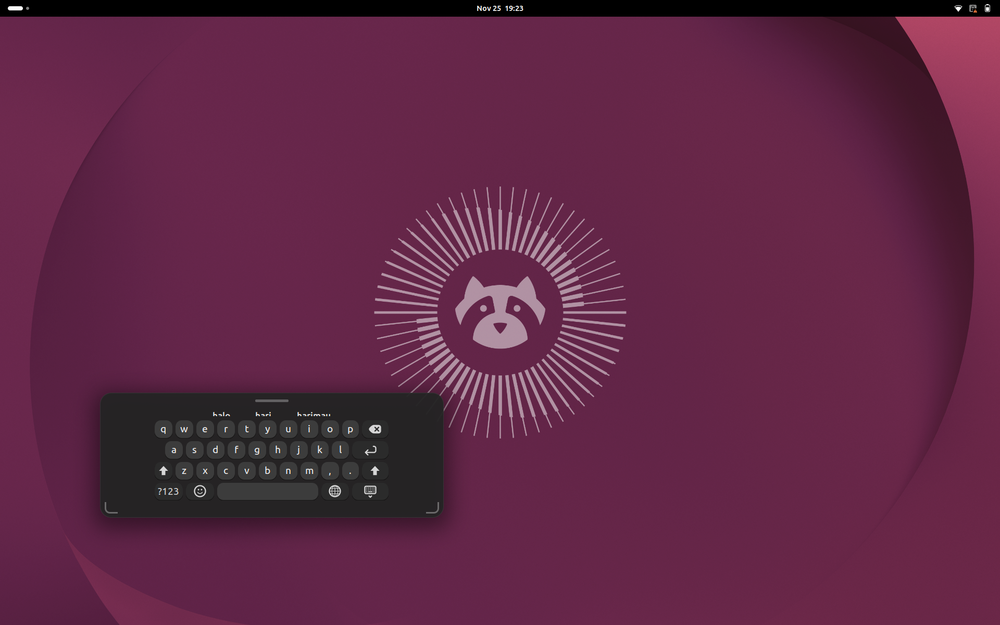
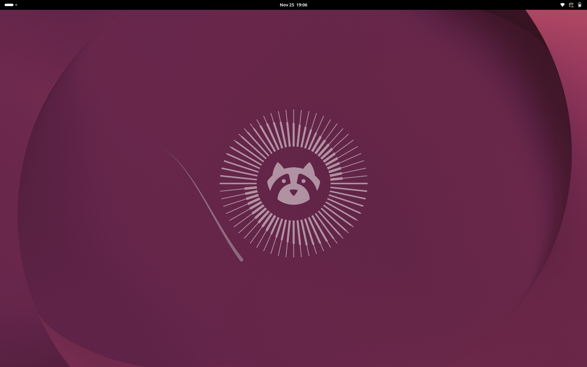

# GNOME Touch Feedback

Extension GNOME Shell (48–50, Wayland) buat laptop layar sentuh, biar rasanya lebih kayak Windows.

- **Tap**: titik muncul waktu jari nempel, lalu ripple + bunyi klik pelan waktu jari diangkat.
- **Swipe**: jejak kuas samar yang ngikutin jari, tebal di ujung jari dan menipis ke ekor. Swipe nggak bunyi.
- **Swipe dari bezel bawah** (harus mulai mepet tepi bawah layar)
  - bagian **tengah** → dock Ubuntu muncul (tap di luar dock buat nyembunyiin lagi)
  - bagian **kiri / kanan** → keyboard layar naik ngikutin jari
- **Keyboard layar mengambang** bertema Ubuntu modern (Yaru gelap + aksen oranye):
  - geser lewat bar di atas keyboard
  - resize lewat pojok kiri atas / kanan atas
  - posisi & ukuran disimpan di `~/.config/touch-feedback/keyboard.json`

Keyboard-nya tetap keyboard bawaan GNOME (layout, emoji, dan saran kata tetap jalan). Extension ini cuma
ngubah posisi, animasi, tema, dan cara munculnya. Laptop non-convertible nggak pernah masuk "mode tablet",
jadi extension ini juga bikin keyboard layar selalu siap begitu input terakhir datang dari layar sentuh.
Keyboard cuma muncul lewat swipe bezel, bukan otomatis waktu kolom teks disentuh
(atur lewat `EDGES.oskOnlyByGesture` di `config.js`).




## Pasang

```bash
./install.sh            # sebagai user biasa
sudo TARGET_USER=nama ./install.sh   # dari root, pasang buat user tertentu
```

Habis itu logout lalu login lagi, karena GNOME di Wayland nggak bisa reload extension.

## Atur

Semua angka (warna, ukuran ripple, tebal & transparansi kuas, lebar zona tengah, jarak dari tepi bawah,
ukuran awal keyboard, durasi animasi, suara on/off) ada di [`touch-feedback@yandi/config.js`](touch-feedback@yandi/config.js).
Tema keyboard ada di [`touch-feedback@yandi/stylesheet.css`](touch-feedback@yandi/stylesheet.css).
Habis ubah, jalankan `./install.sh` lagi lalu logout-login.

Reset posisi keyboard: `rm ~/.config/touch-feedback/keyboard.json`.

## File

| File | Isi |
|---|---|
| `extension.js` | nyalain/matiin semua bagian |
| `brush.js` | titik, ripple, jejak kuas, suara klik |
| `edges.js` | zona swipe bezel bawah (dock / keyboard) |
| `osk.js` | keyboard mengambang: posisi, animasi slide, geser & resize |
| `stylesheet.css` | tema keyboard |
| `config.js` | semua setelan |
